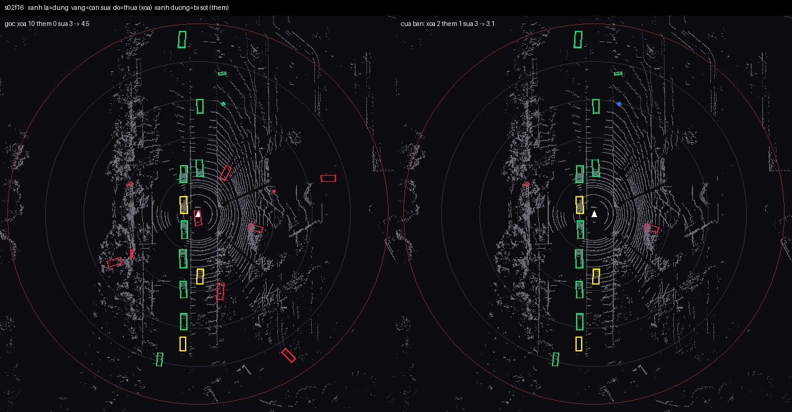

# Báo cáo Day 14 — Phạm Trọng Hiện — 2A202603218

> Sao chép file này thành `report/individual/<MSSV>_<HoTen>.md` (không dấu), ví dụ `2A20260000_NguyenVanAn.md`.

- Mã học viên dùng với `--student`: `218`
- `seed_tag` trong `frames_A.txt`: `393590736f`

## 1. Dự đoán trước sweep (bước 5b)

Ghi **trước** khi chạy `scripts/pp_sweep.py`, rồi commit và push ngay (lịch sử commit là bằng chứng thời điểm viết). Không sửa phần này sau khi có kết quả.

- Tham số tôi nghĩ giảm công sửa nhiều nhất: score_thr (đang hơi thấp)
- Vì sao (nhìn ảnh BEV tập A: box thừa nhiều hay box sót nhiều?): vì box đang bị đánh thừa quá nhiều

## 2. Tập A: sửa tay và tune

| Cấu hình           | Xóa | Thêm | Sửa | Chi phí |
| ------------------ | --: | ---: | --: | ------: |
| Gốc                |  47 |    5 |  14 |    26.1 |
| `best_config.json` |   8 |    8 |  13 |    16.9 |

- Tham số đã đổi trong `best_config.json`: tăng từ `score_thr` từ 0.10 lên 0.50.
- Kết quả leave-one-out (dán các dòng `scripts/pp_sweep.py` in ra):
  Leave-one-out (chọn trên các frame còn lại, chấm trên frame bỏ ra):
  s01f23: cấu hình chọn {'score_thr': '0.5', 'min_points': '0'} → 8.7 (tốt nhất có thể 8.7)
  s02f16: cấu hình chọn {'score_thr': '0.5', 'min_points': '0'} → 3.1 (tốt nhất có thể 3.1)
  s05f18: cấu hình chọn {'score_thr': '0.5', 'min_points': '0'} → 5.1 (tốt nhất có thể 5.1)
- Cấu hình có ổn định trên từng frame không? Vì sao tôi vẫn chọn (hoặc không chọn) nó: Trên tập A, cả ba lượt leave-one-out đều chọn cùng một cấu hình và đạt chi phí thấp nhất trong các cấu hình đã thử trên frame được giữ lại để chấm. Tôi chọn cấu hình này vì số hộp cần xóa giảm từ 47 xuống 8. Dù phải thêm 3 hộp, tổng chi phí sửa vẫn giảm từ 26,1 xuống 16,9. Kết quả này dựa trên 3 frame của tập A.

## 3. Trước/sau (bước 8)

- `scripts/pp_compare.py` báo giảm 35% công sửa trên tập A.
- Dự đoán ở mục 1 đúng hay sai? Giải thích bằng số box xóa/thêm/sửa: dự đoán ở mục 1 đúng, Khi tăng `score_thr` từ `0.10` lên `0.50`, số hộp cần xóa giảm từ 47 xuống 8 và số hộp cần sửa giảm từ 14 xuống 13. Số hộp cần thêm tăng từ 5 lên 8 vì ngưỡng cao hơn cũng lọc mất một số dự đoán đúng. Phần chi phí giảm do bớt xóa hộp thừa lớn hơn phần chi phí tăng do phải thêm hộp, nên tổng công sửa giảm.

## 4. Tập B

Số đo từ `scripts/pp_prelabel.py --frames d14_<ID>/frames_B.txt --config d14_<ID>/best_config.json --gt d14_218/ref_B.json`:

| Xóa | Thêm | Sửa | Chi phí |
| --: | ---: | --: | ------: |
|  42 |   14 |  38 |    45.6 |

- Loại box tốn công sửa nhất ở tập B: `Car`, với 20 hộp cần xóa, 7 hộp cần thêm và 38 hộp cần chỉnh. Lớp này chiếm 32,0 trên tổng 45,6 điểm chi phí. Trong đó, riêng việc chỉnh 38 hộp đã khớp với nhãn tham chiếu chiếm 19,0 điểm.

## 5. Giới hạn

- Nêu ít nhất 2 giới hạn (ví dụ: chỉ 3 frame tune; model KITTI không có Truck/Bus; chi phí là công thức, chưa phải thời gian sửa thật):
  Chỉ dùng 3 frame tập A để chọn `score_thr` và `min_points`. Cấu hình có chi phí thấp nhất trên tập A có thể cho kết quả khác trên các cảnh có mật độ xe hoặc số điểm LiDAR khác.
  Chi phí sửa là điểm có trọng số cho số hộp cần xóa, thêm và chỉnh trong phạm vi 50 m. Mức giảm 35% trên tập A là mức giảm theo công thức chấm. Tôi chưa đo thời gian chỉnh sửa thực tế trong CVAT.
